# Tarea 09 – Implantación de Odoo 19 Community

Franco Naraza

## 1. Introducción

En esta práctica se ha realizado la instalación y configuración de **Odoo 19 Community** utilizando Docker Compose. El entorno está formado por tres servicios: Odoo, PostgreSQL y pgAdmin.

El objetivo es disponer de un sistema de gestión empresarial funcional, crear dos bases de datos y realizar diferentes operaciones comerciales desde Odoo.

## 2. Estructura del proyecto

El proyecto se ha organizado de la siguiente manera:

```text
sxe_tarea09/
├── .env
├── .env.example
├── .gitignore
├── docker-compose.yml
├── config/
│   └── odoo.conf
├── addons/
└── capturas/
```

- `docker-compose.yml`: configuración de los contenedores.
- `.env`: variables de entorno y credenciales.
- `.env.example`: ejemplo de las variables necesarias.
- `.gitignore`: archivos que no deben subirse al repositorio.
- `config/odoo.conf`: configuración de Odoo.
- `addons/`: directorio para módulos adicionales.
- `capturas/`: evidencias de la práctica.

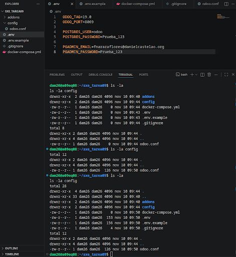


## 3. Despliegue con Docker Compose

Para realizar la instalación se han utilizado tres contenedores:

| Servicio | Imagen | Puerto |
|---|---|---|
| Odoo | Odoo 19.0 | 8069 |
| PostgreSQL | PostgreSQL 16 | 5432 |
| pgAdmin | pgAdmin 4 | 5050 |

Los servicios se comunican mediante la red interna de Docker. Odoo utiliza PostgreSQL como sistema de almacenamiento de datos y pgAdmin permite administrar la base de datos.

Para iniciar los contenedores se utiliza:

```bash
docker compose up -d
```

Para comprobar su estado:

```bash
docker compose ps
```

Acceso a los servicios:

- Odoo: http://localhost:8069
- pgAdmin: http://localhost:5050

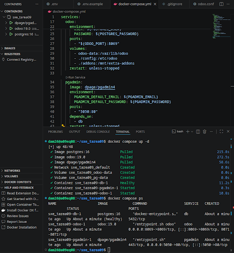

## 4. Creación de las bases de datos

Se han creado dos bases de datos desde el gestor de Odoo. En ambas se ha seleccionado el idioma español y España como país.

### 4.1. Base de datos demo

Se ha creado la base de datos `demo`, activando la opción de datos de demostración para disponer de información de ejemplo.

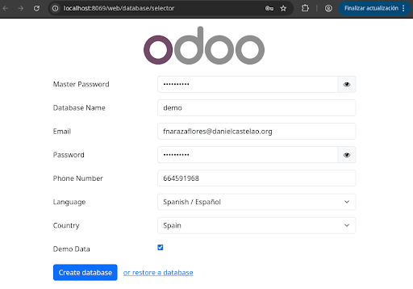

### 4.2. Base de datos real

También se ha creado la base de datos `real`, esta vez sin activar los datos de demostración. De esta manera se dispone de una base de datos limpia.

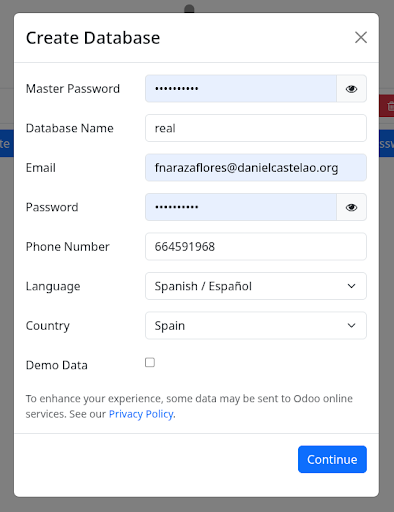

### 4.3. Comprobación de las bases de datos

Después de crear ambas bases, se ha comprobado que aparecen correctamente en el gestor de bases de datos de Odoo.

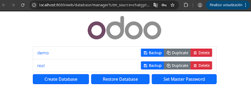

## 5. Configuración de pgAdmin

Se ha configurado pgAdmin para conectarse al servidor PostgreSQL del entorno Docker.

Los datos principales de conexión son:

| Parámetro | Valor |
|---|---|
| Host | `db` |
| Puerto | `5432` |
| Usuario | `odoo` |
| Servidor registrado | PostgreSQL Odoo |

Una vez establecida la conexión, se pueden consultar las bases de datos disponibles en PostgreSQL.

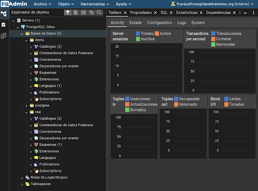

## 6. Instalación de aplicaciones

En la base de datos `demo` se han instalado las siguientes aplicaciones:

- Contacts.
- Sales.
- Invoicing.
- Inventory.

Estas aplicaciones permiten gestionar contactos, ventas, facturas e inventario desde Odoo.

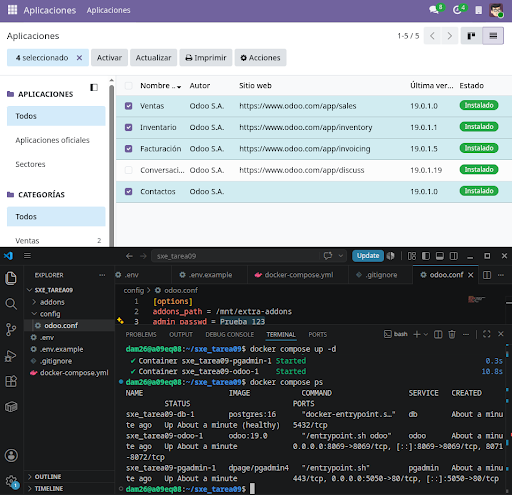

---

# 7. Ejercicio 1 – Tipos de producto e impuestos

En este ejercicio se han comprobado los diferentes tipos de producto disponibles en Odoo 19 Community.

### 7.1. Producto de tipo Bienes

Se ha creado un producto de tipo Bienes y se ha comprobado que permite activar la opción de rastreo de inventario.

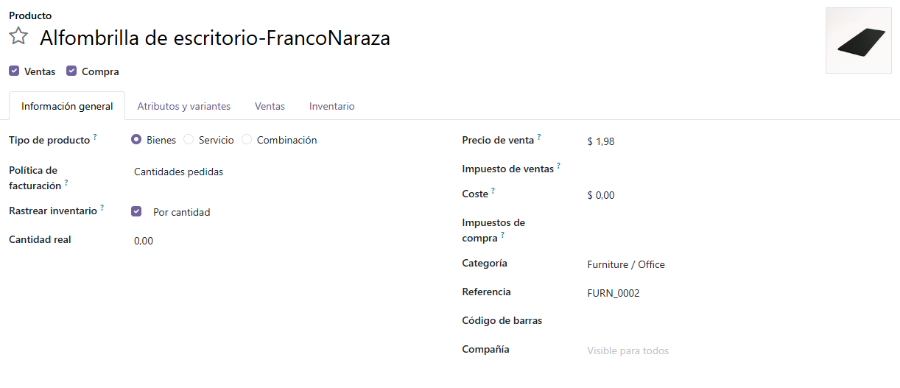

### 7.2. Producto de tipo Servicio

Se ha creado un producto de tipo Servicio para representar un servicio que se puede ofrecer a los clientes.

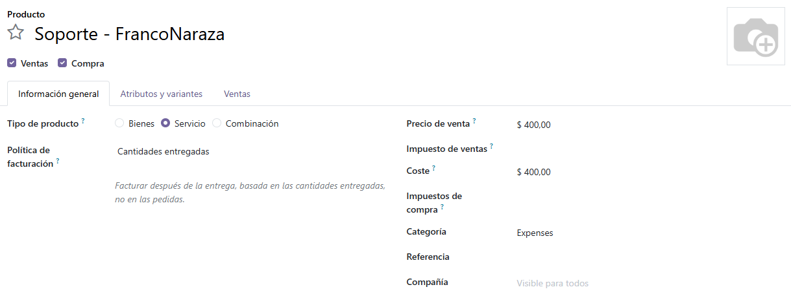

### 7.3. Producto de tipo Combinación

Se ha comprobado y configurado un producto de tipo Combinación.

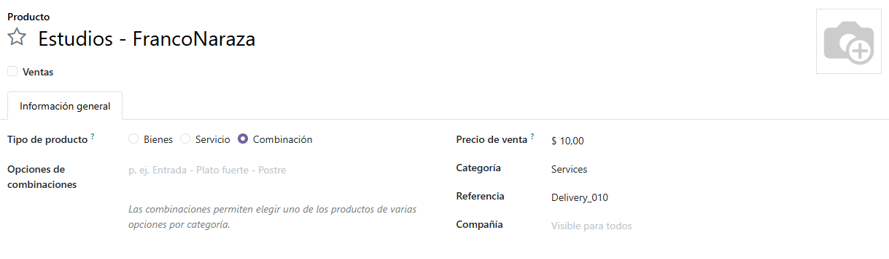

### 7.4. Creación de un cliente

Se ha creado el contacto `Cliente Prueba`, incluyendo sus datos de identificación y la información necesaria para realizar operaciones comerciales.

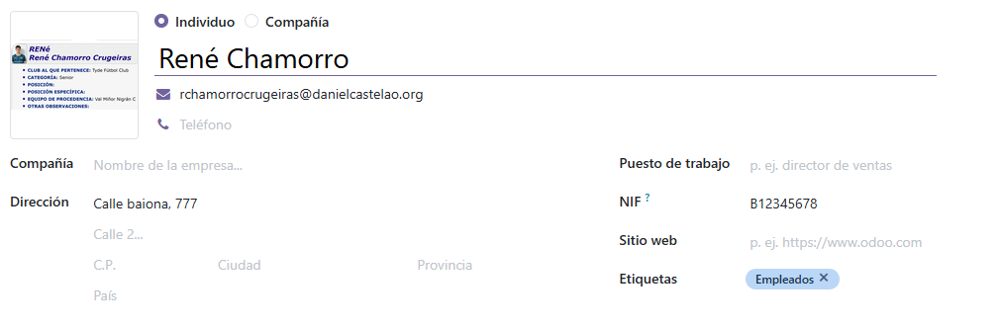

### 7.5. Configuración de productos e impuestos

Se han configurado los siguientes productos:

| Producto | Tipo | Precio | Impuesto |
|---|---|---:|---:|
| Hora de soporte | Servicio | 40 € | 21 % |
| Libro técnico | Bienes | 25 € | 4 % |

**Hora de soporte:**

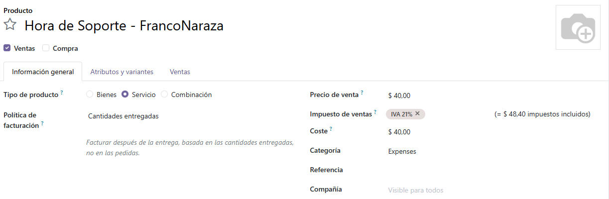

**Libro técnico:**

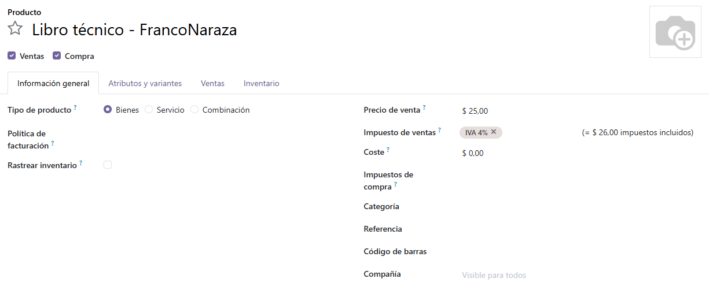

---

# 8. Ejercicio 2 – Operaciones comerciales

En este ejercicio se ha realizado un proceso de venta completo, desde la creación de un presupuesto hasta el registro del pago.

### 8.1. Creación del presupuesto

Se ha creado un presupuesto para el cliente `Cliente Prueba`, incluyendo los productos Hora de soporte y Libro técnico.

El resultado económico es el siguiente:

| Concepto | Importe |
|---|---:|
| Base imponible | 65,00 € |
| IVA | 9,40 € |
| **Total** | **74,40 €** |

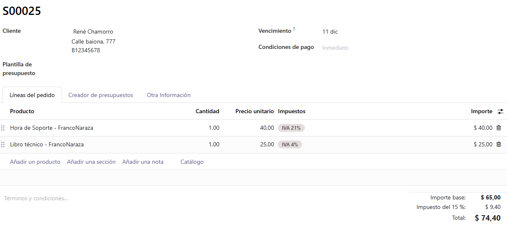

### 8.2. Confirmación del pedido

Después de crear el presupuesto, se ha confirmado para convertirlo en un pedido de venta.

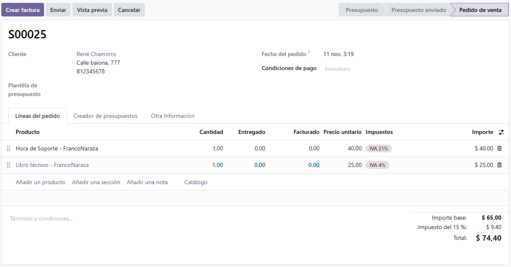

### 8.3. Creación de la factura

A partir del pedido de venta se ha generado una factura. Inicialmente se encontraba en estado borrador.

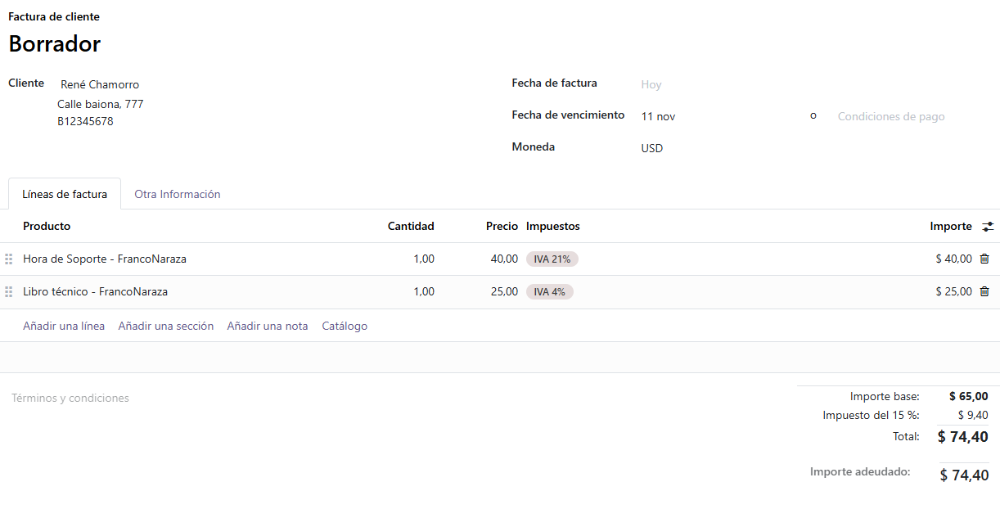

### 8.4. Publicación de la factura

Se ha publicado la factura para confirmar la operación contable.

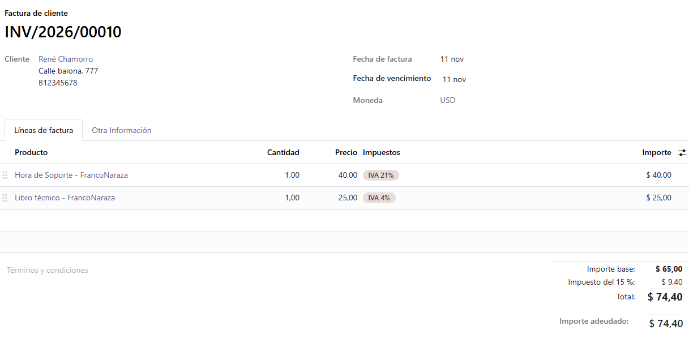

### 8.5. Generación del PDF

También se ha generado el documento PDF de la factura para comprobar su contenido.

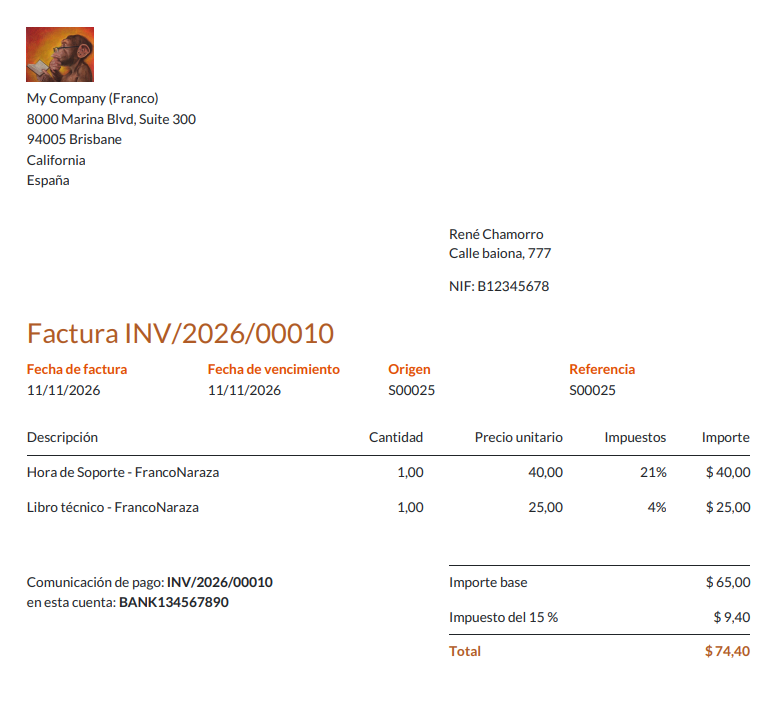

### 8.6. Registro del pago

Finalmente, se ha registrado el pago de la factura y se ha comprobado que su estado aparece como pagado.

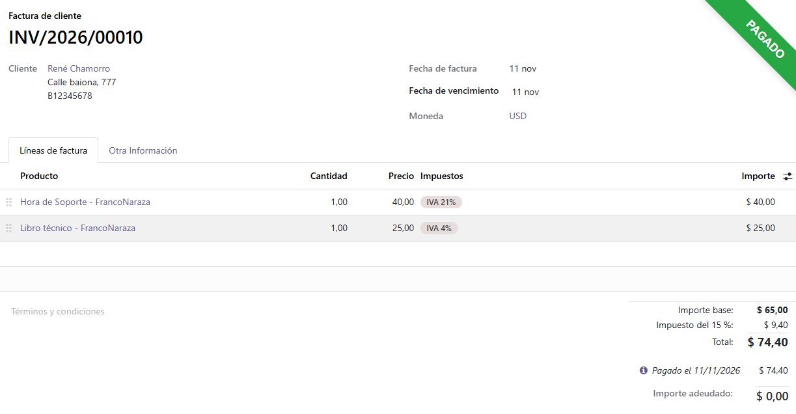

### 8.7. Factura de proveedor

Se ha localizado una factura de proveedor existente en los datos de demostración de Odoo.

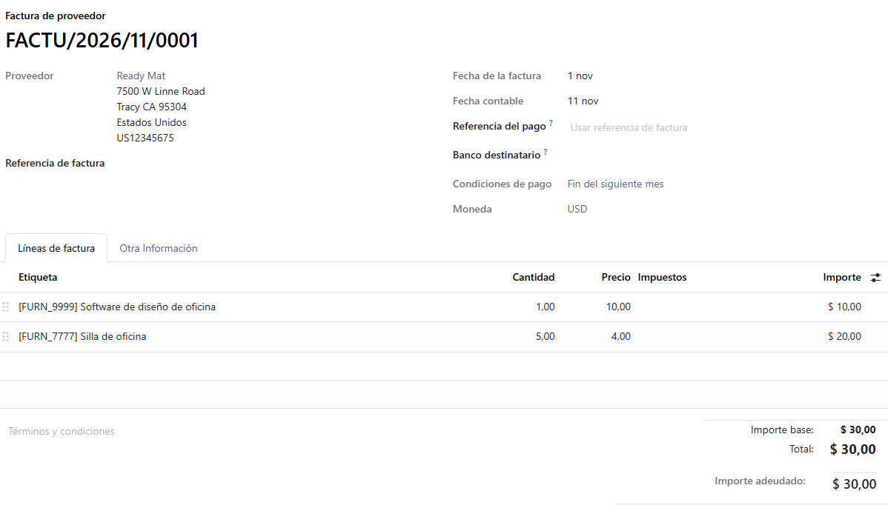

### 8.8. Programación de una actividad

Desde el contacto `Cliente Prueba` se ha programado una actividad de tipo llamada, con el resumen «Llamar al cliente para seguimiento».

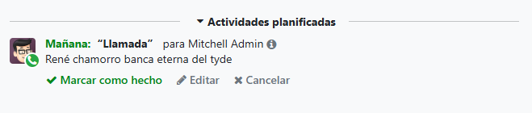

---

# 9. Ejercicio 3 – Facturas publicadas agrupadas por cliente

En este ejercicio se ha accedido al apartado de facturas de clientes y se ha aplicado un filtro para mostrar únicamente las facturas publicadas.

Posteriormente, se han agrupado por cliente y se ha guardado la configuración como favorito con el nombre:

`Facturas publicadas agrupadas por cliente`

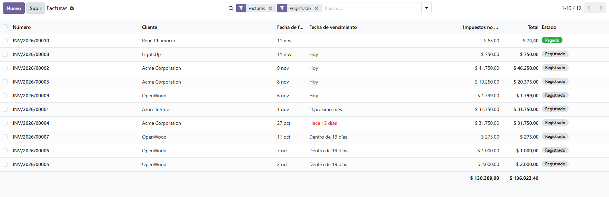

---

# 10. Ejercicio 4 – Modo desarrollador y campos técnicos

En este ejercicio se ha activado el modo desarrollador de Odoo utilizando dos procedimientos diferentes.

### 10.1. Activación desde los ajustes

Se ha activado el modo desarrollador desde el apartado de ajustes de Odoo.

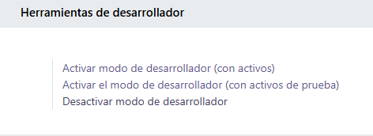

### 10.2. Activación mediante URL

También se ha activado utilizando el parámetro `?debug=1` en la dirección del navegador.


### 10.3. Identificación de campos técnicos de contactos

Mediante las herramientas de depuración se ha identificado:

| Campo | Nombre técnico | Modelo |
|---|---|---|
| CIF/NIF | `vat` | `res.partner` |

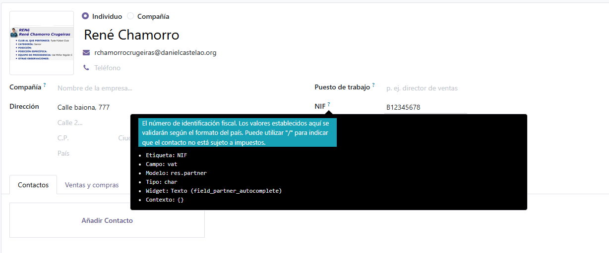

### 10.4. Modelo técnico de las facturas

Se ha consultado la información técnica de una factura para identificar el modelo utilizado por Odoo.

El modelo técnico correspondiente a las facturas es:

`account.move`

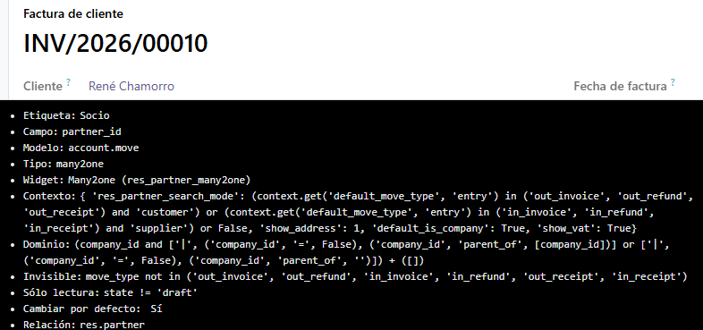

---


# 11. Declaración de uso de inteligencia artificial

>  No ha sido necesario utilizar inteligencia artificial para realizar esta práctica, ya que la guía proporcionada por el profesor ha sido suficiente para comprender y completar los diferentes apartados.

